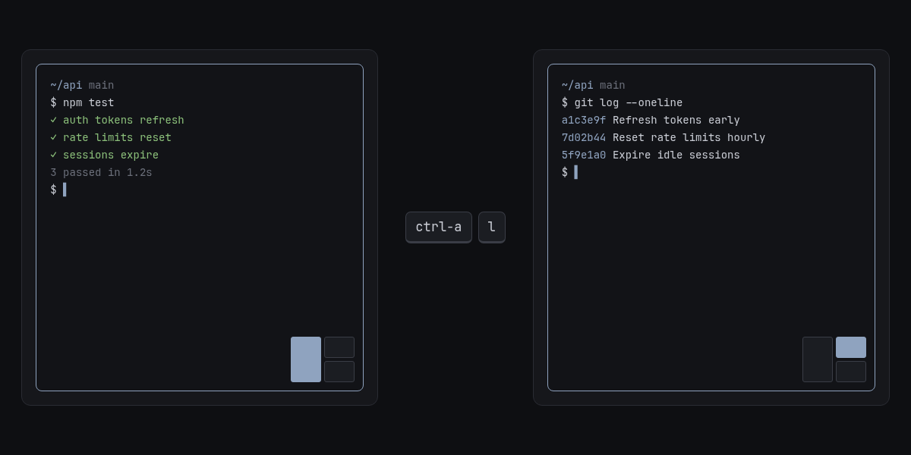

# Zen panes for Herdr

Keep a zoomed pane zoomed while you move between panes in the [Herdr](https://herdr.dev) desktop app.
With a pane zoomed, moving left, right, up or down shows the pane next to it, zoomed.
With nothing zoomed, moving works as it always does.



## Install

Ask the agent in your Herdr window:

```text
Read ~/.config/herdr-app/AGENTS.md, then add this mod: github.com/suppa-duppa-labs/herdr-zen-panes
```

Or by hand, on the computer that runs the Herdr app (run it again to update):

```sh
mkdir -p ~/.config/herdr-app/mods && curl -fsSL https://github.com/suppa-duppa-labs/herdr-zen-panes/archive/main.tar.gz | tar -xz -C ~/.config/herdr-app/mods --strip-components=2 herdr-zen-panes-main/mods/zen-panes
```

## Turn it on

Herdr's shipped layouts are read-only, so first duplicate yours with Duplicate layout in the command palette, or:

```sh
herdr-app do layout.clone '{"name":"main","as":"my-layout"}'
```

In `~/.config/herdr-app/layouts/my-layout.json`, add this to the root node.
It draws nothing.

```json
"floating": [ { "id": "zen-panes", "content": { "mod": "zen-panes" } } ]
```

Then point your pane keys at it in `~/.config/herdr-app/keys.json`, in place of `pane.go`:

```json
"ctrl-a h": "zen-panes.go:left",
"ctrl-a j": "zen-panes.go:down",
"ctrl-a k": "zen-panes.go:up",
"ctrl-a l": "zen-panes.go:right",
"ctrl-a left": "zen-panes.go:left",
"ctrl-a down": "zen-panes.go:down",
"ctrl-a up": "zen-panes.go:up",
"ctrl-a right": "zen-panes.go:right"
```

## Notes

Made for Herdr app 0.1.9 and later; it works from terminal panes and mod panes.
The keys only work in layouts that have the floating block; in others they show an unknown command error.
Herdr can't find a zoomed pane's neighbour, so the mod unzooms, moves and zooms again, and the full layout can show for one frame.
[RECIPE.md](RECIPE.md) is the brief to build the mod from scratch.
MIT, see [LICENSE](LICENSE).
