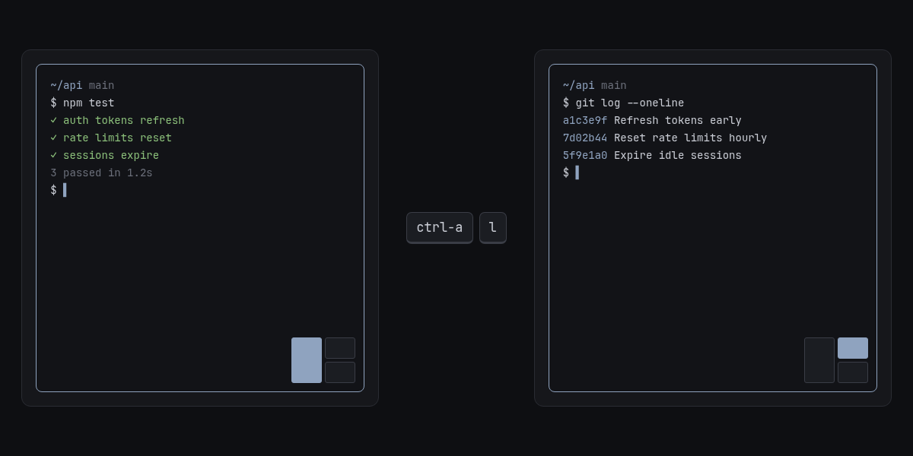

# Zen panes

Moving between panes keeps zoom on: with a pane zoomed, `zen-panes.go:<direction>` shows the pane next to it in that direction, zoomed in its place.
With nothing zoomed it is `pane.go`.
The mod draws nothing.

**What you see:**

- Nothing of the mod itself: it is an empty floating block, and Herdr draws no frame around a floating block whose content is empty.
- With a pane zoomed, a move key swaps the zoomed pane for its neighbour in that direction; the tab stays zoomed.
- With nothing zoomed, the move key focuses the neighbour as `pane.go` does.

**How it behaves:**

- `zen-panes.go:left`, `:right`, `:up` and `:down`, bound in `keys.json` like any `<mod>.<command>`.
- Not zoomed: runs `pane.go {direction}`, so its errors (a focused layout terminal block) show as `pane.go`'s.
- Zoomed: runs `pane.zoom {pane}` on the zoomed pane to unzoom the tab, then, on the first render that sees the tab unzoomed, `pane.go {direction}` and `pane.zoom` with no pane, which zooms whichever pane has focus by then.
- No neighbour that way: the same pane is zoomed again.
- The zoomed pane is found by the focused pane's tab in `panes()`, so it works from terminal panes and mod panes alike.
- If another tab is shown before the unzoom lands, the move is dropped.
- Any other command is ignored.

**Built from:**

- One mod, `zen-panes`, `place: "none"`, used as a floating block on the root of a cloned layout: `{ "id": "zen-panes", "content": { "mod": "zen-panes" } }`.
- `main.js`: `nextCommand()` in a loop started from `init`, `focused()`, `panes()`, `run("pane.go")`, `run("pane.zoom")`; `render()` returns an empty `div()`.

**Watch out:**

- `pane.go` finds neighbours from the panes' on-screen bounds, among the panes shown; while zoomed only the zoomed pane is shown, so `pane.go` does nothing, and mods can't read pane geometry to find the neighbour themselves.
- The bounds are recorded while a frame is drawn, so `pane.go` has to wait for a frame of the unzoomed layout; running unzoom, `pane.go` and zoom back to back moves nowhere.
  That one frame can show.
- `<mod>.<command>` reaches shown copies only, so the block must be in the layout and not hidden: a hidden layout block never starts again after a reload, while a floating block with empty content starts and stays invisible.
- Herdr never docks a new mod into its shipped layouts, and they are read-only: the layout has to be a clone.

**Done when:**

- `herdr-app check mods/zen-panes` passes.
- With two panes side by side, the left one zoomed, `zen-panes.go:right` shows the right one zoomed and focused.
- With nothing zoomed, `zen-panes.go:right` focuses the right pane and nothing zooms.
- With the left pane zoomed, `zen-panes.go:left` leaves it zoomed and focused.
- The same works with a mod pane (a Files pane) focused.
